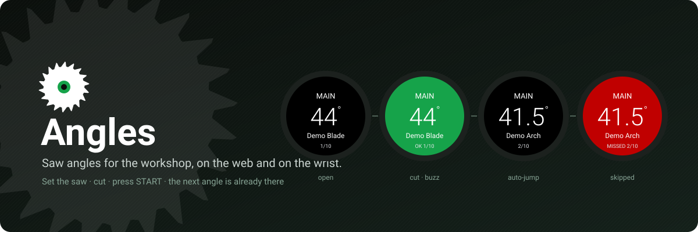
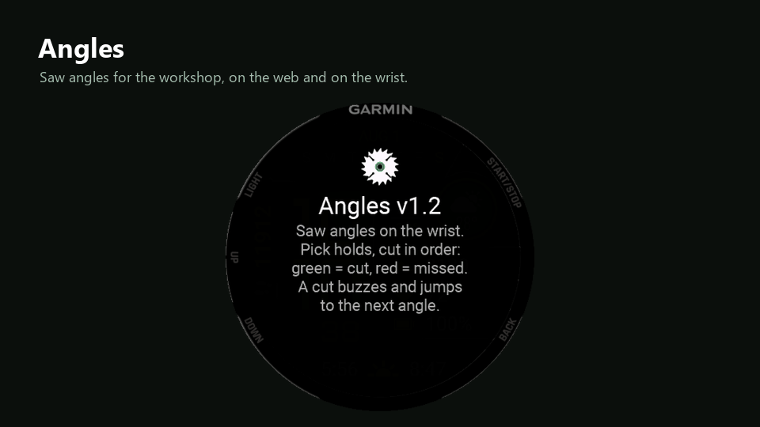
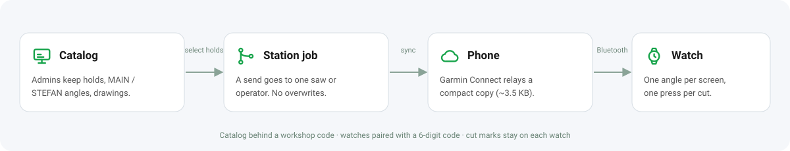
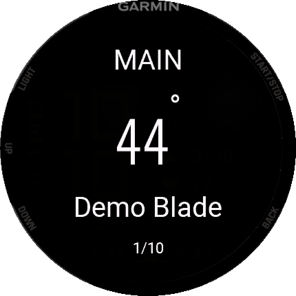
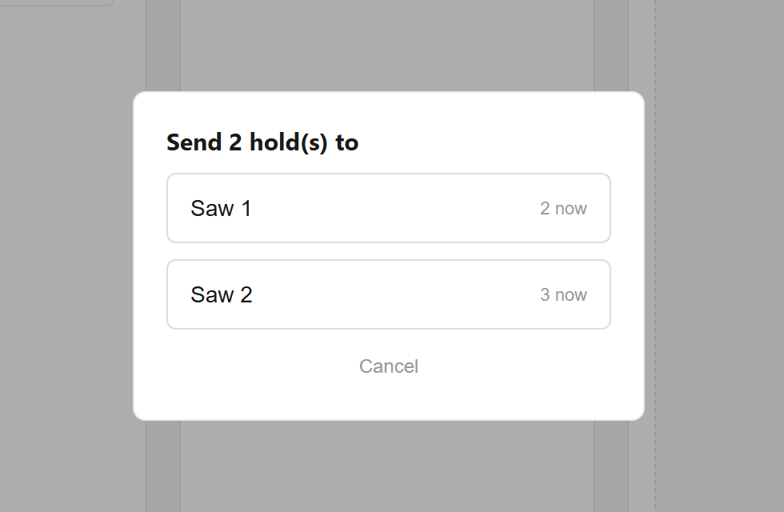
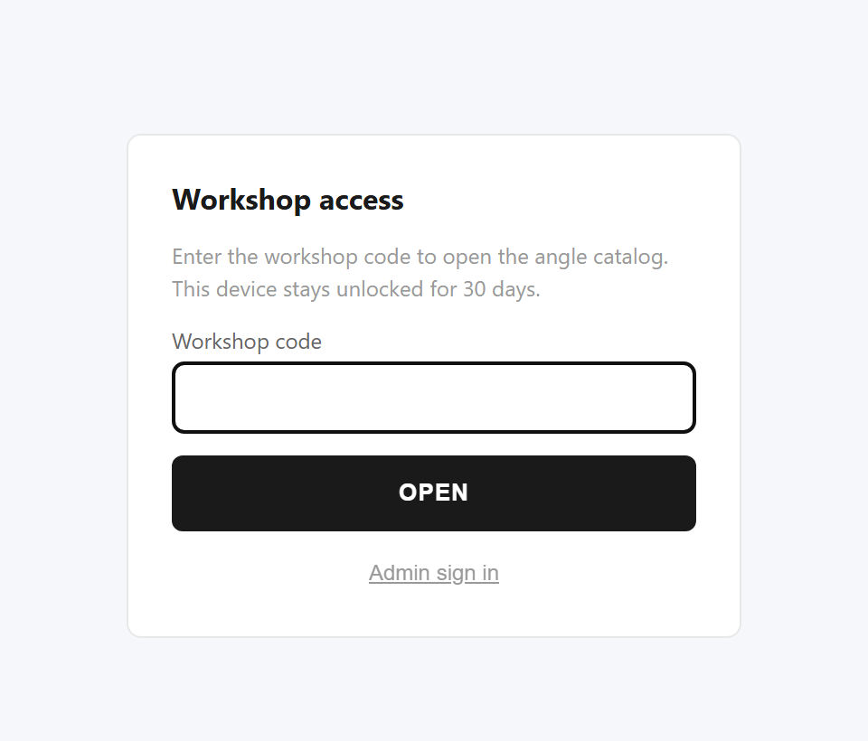
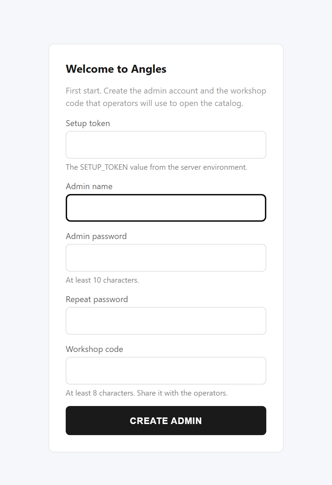
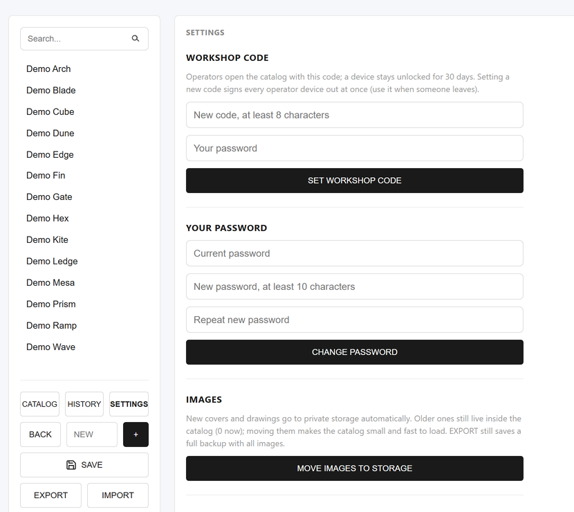
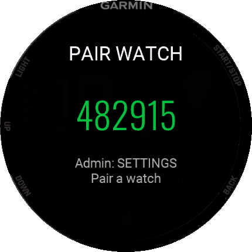
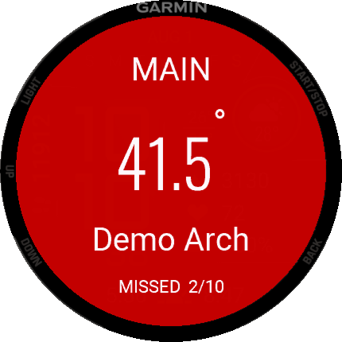

<p align="center">
  
</p>

<p align="center">
  <b>Saw-angle reference for a plywood workshop.</b><br>
  A shared web catalog of cut angles, a phone work mode, printable sheets,<br>
  and a Garmin watch app that puts the next angle on the operator's wrist.
</p>

<p align="center">
  <a href="CHANGELOG.md"></a>
  <a href="garmin/README.md"></a>
  
  
  
  
  
</p>

<p align="center">
  <a href="#how-it-works">How it works</a> ·
  <a href="#features">Features</a> ·
  <a href="#screenshots">Screenshots</a> ·
  <a href="docs/CUTTING.md">Cutting above 45°</a> ·
  <a href="docs/WATCH_SETUP.md">Watch setup</a> ·
  <a href="docs/MULTI_OPERATOR.md">Several operators</a> ·
  <a href="#quick-start">Quick start</a>
</p>

---

<p align="center">
  
  <br><sub>30-second walkthrough on demo data. Static version: the screenshots below.</sub>
</p>

## Why it exists

Built at **AVA Volumes**, where climbing holds and volumes are made from
plywood panels. Every panel edge is cut at a bevel angle; one hold needs many of
them and a job is usually several holds at once. Angles replaces printed lists
and memory with:

- **one shared catalog** of holds and angles, edited by named admins with a change history;
- **one merged, sorted cut list** per saw set-up — **MAIN** (panel flat, up to 45°) and **STEFAN** (panel clamped upright, for edges above 45°, see [`docs/CUTTING.md`](docs/CUTTING.md));
- **tick-off progress at the saw** — on a phone, or on a Garmin watch where one button press marks the cut and jumps to the next angle.

The web app is used daily on the workshop floor.

## How it works

<p align="center">
  
</p>

<table>
<tr>
<td width="44%" align="center"></td>
<td>

**At the saw**

1. Set the saw to the angle on the wrist.
2. Cut, press **START** — the screen turns **green** and the watch buzzes once.
3. 0.7 s later the **next open angle** is on the screen. No scrolling.
4. Marked an angle while a higher one is still open? **Two buzzes** and the skipped one turns **red** — noticed at the saw, not at assembly.
5. Every press is saved on the watch; it keeps working without the phone.

</td>
</tr>
</table>

## Features

<table>
<tr>
<td width="50%" valign="top">

 **Protected catalog** — operators open it with a workshop code (30 days per device), admins with their own password. A new code signs every device out.

</td>
<td width="50%" valign="top">

 **Stations** — one job per saw or operator. Sending a job to one station never touches another.

</td>
</tr>
<tr>
<td valign="top">

 **Garmin watch app** — BIG MODE, colored list, auto-jump with vibration, offline after sync. Paired to a station with a 6-digit code.

</td>
<td valign="top">

 **Merge on conflict** — two admins saving at once: changes are combined; only true conflicts ask who wins.

</td>
</tr>
<tr>
<td valign="top">

 **Drawings in private storage** — covers and cutting drawings live in a private Vercel Blob store, served after the same access check.

</td>
<td valign="top">

 **First run** — an empty install asks for the admin and the workshop code, then guides you to add holds, angles and drawings.

</td>
</tr>
<tr>
<td valign="top">

 **Work mode and print** — phone-friendly tick-off list, A4 sheets for ALL / MAIN / STEFAN.

</td>
<td valign="top">

 **History and backups** — every save is logged with the admin's name; EXPORT makes a self-contained JSON backup.

</td>
</tr>
</table>

## Screenshots

All screenshots use demo data.

**Web**

<p align="center">
  
  <br><sub>Pick the holds of the job: one merged list for MAIN and one for STEFAN.</sub>
</p>

<p align="center">
  
  &nbsp;
  
  &nbsp;
  
  <br><sub>Send a job to a station · workshop access · phone work mode</sub>
</p>

<p align="center">
  
  &nbsp;
  
  <br><sub>First run · admin settings (workshop code, password, images, stations and watches)</sub>
</p>

**Garmin watch** (Instinct 3 AMOLED 45mm simulator)

| Holds | Pairing | BIG MODE | Cut | Missed | List |
|---|---|---|---|---|---|
|  |  |  |  |  |  |

## Cutting angles above 45°

The saw blade tilts only up to 45°. Angles up to 45° are cut on the normal
clamping beam with the panel flat (**MAIN**). For steeper edges a second
clamping beam on the saw holds the blank **upright** (**STEFAN**): with the
panel standing, the same 0–45° tilt produces edges above 45°
(`edge = 90° − tilt`). The app keeps both lists apart, sorted high → low so the
tilt moves one way through the job. Details: [`docs/CUTTING.md`](docs/CUTTING.md).

## Garmin watch

1. Install the `.prg` on the watch (USB, `GARMIN\APPS`).
2. Admin: **SETTINGS → OPEN PAIRING**. Watch: **FROM PHONE** shows a 6-digit code. Admin enters it and picks the station.
3. Operators press **⌚** on the website, pick the station, then **FROM PHONE** on the watch.

Step by step with troubleshooting: [`docs/WATCH_SETUP.md`](docs/WATCH_SETUP.md).
Several sawyers and watches: [`docs/MULTI_OPERATOR.md`](docs/MULTI_OPERATOR.md).
Watch app internals and build: [`garmin/README.md`](garmin/README.md).

## Quick start

```bash
npm install
npm run dev          # UI only; /api needs Vercel dev
```

Full stack locally:

```bash
vercel env pull .env.local
node --env-file=.env.local scripts/db-setup.mjs
vercel dev
```

Server-only environment variables (never with a `VITE_` prefix):

```env
DATABASE_URL=postgresql://...
SESSION_SECRET=long-random-secret
SETUP_TOKEN=...                 # 24+ chars; the first-run screen asks for it
BLOB_READ_WRITE_TOKEN=...       # set by connecting a private Vercel Blob store
SEED_WORKSHOP_CODE=...          # optional initial workshop code
```

On an empty database the app shows the first-run screen; seeding users from env
(`SEED_PASSWORD_<NAME>` or `SEED_USER_PASSWORDS`) is optional. Deploy, first run
and upgrade from v1.5: [`docs/OPERATIONS.md`](docs/OPERATIONS.md#0-deploy-and-first-run).

Quality gates (all enforced in CI):

```bash
npm run lint && npm test && npm run build && npm run audit
```

<details>
<summary><b>Project structure</b></summary>

```text
api/                     Vercel Functions
├── _lib/                auth, sessions, access, rate limit, stores, schema.sql
├── account/[action].js  first run, workshop code, password, status
├── state.js             GET/PUT shared catalog (revision-locked)
├── history.js           audit log
├── images.js            private Blob images (upload / read)
├── watch.js             watch catalog (paired token), pairing, stations, Send to watch
└── login.js logout.js session.js
src/                     React SPA
├── features/            access (gate, onboarding), admin (settings, stations, images, merge), operator
├── components/          shared UI, AdminPage
├── domain/              pure logic: angles, migration, diff, merge
├── storage/             API clients, import/export, work progress
└── App.jsx main.jsx
garmin/                  Connect IQ watch app (Monkey C)
docs/                    CUTTING, WATCH_SETUP, MULTI_OPERATOR, OPERATIONS, ARCHITECTURE, ROADMAP, assets/
```

See [`docs/ARCHITECTURE.md`](docs/ARCHITECTURE.md).
</details>

<details>
<summary><b>Admin panel</b></summary>

- Open `/#/admin` or click **ADMIN**. Sign-in is checked only by the server; the session is an httpOnly cookie that carries a fingerprint of the password, so a password change signs out every other device.
- **SAVE** sends the full catalog with its revision. If someone saved meanwhile, the draft is merged with the latest catalog by hold/angle id and saved again; only true conflicts ask who wins.
- **HISTORY** shows who changed what and when.
- **SETTINGS**: workshop code, own password, moving images to storage, stations and watch pairing.
- **EXPORT** downloads a self-contained JSON backup (images inlined); **IMPORT** stages a draft that reaches the database only on SAVE.
</details>

<details>
<summary><b>Data and storage</b></summary>

- Neon Postgres: `app_state` (catalog JSON + revision), `change_log`, `users`, `settings` (workshop code hash and version), `stations` (one job each), `watch_devices` (SHA-256 of each watch token), `login_attempts`.
- Covers and drawings: private Vercel Blob store, referenced as `/api/images?p=img/<id>`; data URLs still work when no store is linked.
- Device-local only: work-mode progress, theme, last chosen station.
- Raster images only (PNG, JPEG, WebP, GIF); SVG is rejected.
</details>

## Security

- Catalog, images, stations and the watch API need a workshop-code device, an admin session or a paired watch token. The workshop cookie uses a key derived from `SESSION_SECRET` and can never pass as an admin session.
- Wrong workshop codes, setup tokens, pairing requests, unknown watch tokens and wrong pairing codes are throttled (IPv6 per /64, plus a global cap for workshop codes). Watches get codes only while an admin has pairing open.
- The first-run screen needs `SETUP_TOKEN` in production, so a fresh deploy cannot be claimed by someone else.
- CSP, HSTS and frame headers in [`vercel.json`](vercel.json); secret scanning and `npm audit` in CI.

Details: [`THREAT_MODEL.md`](THREAT_MODEL.md), [`SECURITY_DEBT.md`](SECURITY_DEBT.md), [`SECURITY_CHECKLIST.md`](SECURITY_CHECKLIST.md). Reporting: [`SECURITY.md`](SECURITY.md).

## Roadmap

- **v2.0 — current.** Workshop access, first run, password change, stations and watch pairing, private image storage, merge on conflict.
- **v2.1 — next.** Branch protection, live watch status, optional per-operator accounts.

Full list: [`docs/ROADMAP.md`](docs/ROADMAP.md) · changes: [`CHANGELOG.md`](CHANGELOG.md) · story: [`docs/RELEASE_NOTES.md`](docs/RELEASE_NOTES.md).

## License

Proprietary — all rights reserved. This is an internal workshop tool and is not
licensed for external use, redistribution, or modification without permission
from the maintainer. See [`LICENSE`](LICENSE).
