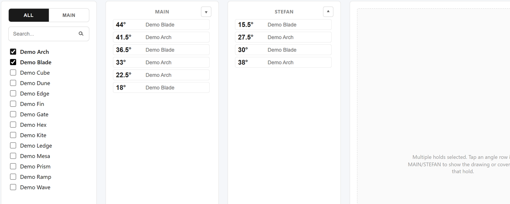
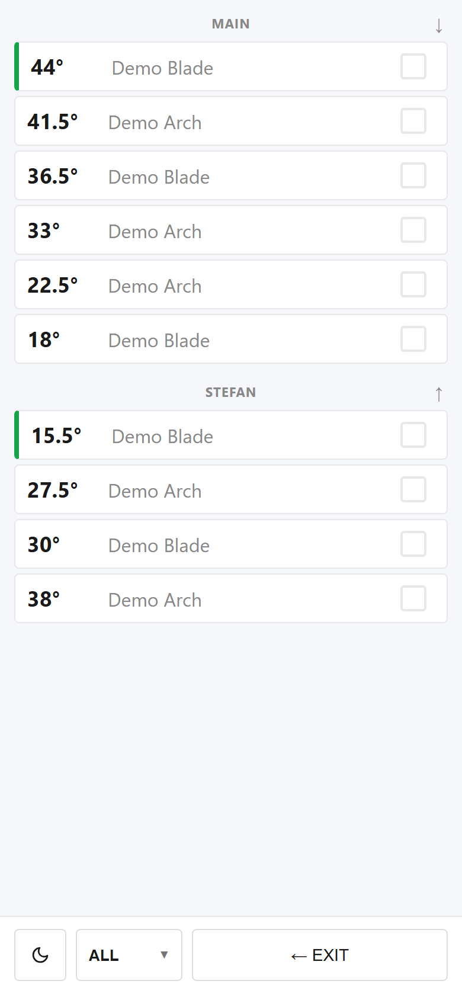
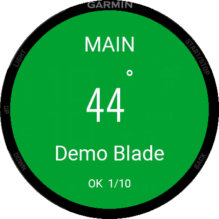

# Angles-proto + Garmin app

> Saw-angle reference tool for the AVA Volumes workshop: a shared web catalog of cut angles for climbing holds and volumes, a phone work mode, printable sheets, and a **Garmin watch app** that shows the next angle on the operator's wrist.

[](CHANGELOG.md)
[](garmin/README.md)
[](https://avacut.vercel.app)
[](https://react.dev)
[](garmin/)
[](https://vercel.com)
[](#license)

**Current versions: web v2.0, Garmin app v1.2** — see the [changelog](CHANGELOG.md) and [release notes](docs/RELEASE_NOTES.md).

<p align="center">
  
</p>

---

## Why it exists

AVA Volumes builds climbing holds and volumes from plywood panels. The panel
edges are cut at bevel angles, a single hold needs many of them, and a job is
usually several holds at once. Angles replaces printed lists and memory with:

1. **One shared catalog** of every hold and its angles, edited by named admins
   with a change history.
2. **One merged, sorted cut list** for the holds of the current job, split by
   saw set-up (**MAIN** and **STEFAN**).
3. **Tick-off progress** at the saw: on a phone (work mode) or on a Garmin
   watch, where one button press marks the cut and jumps to the next angle.

The app is used daily on the workshop floor.

## What It Does

Operators select one or more holds, see their angles for **MAIN** (normal
clamping beam, panel flat, up to 45°) and **STEFAN** (clamping beam that holds
the blank vertically, for edges steeper than 45°), open the cutting drawing for
a row, use a phone-friendly work mode, print A4 reference sheets, or send the
selection to the watch.

Admins sign in as a named user and edit one shared catalog stored in Neon Postgres through same-origin Vercel Functions. Every successful catalog save is revision-locked and logged to a change history.

How the two set-ups work and how angles above 45° are cut on a saw whose blade
tilts only to 45°: [`docs/CUTTING.md`](docs/CUTTING.md).

---

## Features

| | |
|---|---|
| **Shared catalog** | Read with a workshop code or an admin session (`GET /api/state`); admin save via `PUT /api/state` |
| **Workshop access** | Operators open the catalog with one shared code (30 days per device); a new code signs every device out |
| **First run** | Empty database → create the admin and the workshop code; empty catalog → guide to add holds, angles, drawings |
| **Dual-table view** | MAIN and STEFAN angle tables, sortable asc/desc |
| **Multi-select products** | Select any number of products; tables update instantly |
| **Drawing viewer** | Click a row to show a drawing; zoom and dedicated print are available |
| **Print mode** | ALL / MAIN / STEFAN layouts for A4 reference sheets |
| **Admin panel** | Add, rename, delete holds and angles; upload drawings and cover images |
| **Named admins** | Created on first run or seeded by `npm run db:setup`; each changes their own password in SETTINGS |
| **Change history** | Admin `HISTORY` view shows who changed what and when |
| **Change notification** | Logged-in users are notified when another user changed the database |
| **Work mode** | Device-local progress for checked angles and work theme |
| **Import / Export** | Export JSON backups (images inlined); import stages a draft that is persisted on SAVE |
| **Merge on conflict** | Two admins saving at once: changes are combined; only true conflicts ask who wins |
| **Private images** | Covers and drawings in a private Vercel Blob store, served after the same access check |
| **Garmin watch app** | Angles of selected holds on the wrist: BIG MODE, colored list, auto-jump with vibration after each cut, saved progress — see [`garmin/README.md`](garmin/README.md) |
| **Stations** | One job per saw or operator; ⌚ sends the selected holds to one station, so jobs never overwrite each other |
| **Watch pairing** | Watches pair to a station with a 6-digit code; the server stores only a hash of the watch token |

---

## Tech Stack

- **React 19** and **Vite 8** for the SPA
- **Vercel Functions** in `/api` for auth, catalog state, and history
- **Neon Postgres** for users, shared catalog JSON, and audit log
- **httpOnly HMAC session cookie** for admin sessions
- **localStorage** only for device-local UI state such as work progress, work theme, and last-seen change id
- **react-hot-toast** for notifications
- **Connect IQ / Monkey C** for the Garmin watch app (`garmin/`)

---

## Project Structure

```text
Angles-proto-garmin-app/
├── api/                 # Vercel Functions (auth, state, history) + _lib shared logic
│   ├── _lib/            # auth, session, db, stateService, rateLimit, schema.sql
│   ├── login.js  logout.js  session.js
│   ├── state.js         # GET/PUT shared catalog
│   ├── history.js       # GET audit log
│   ├── account/[action].js  # first run, workshop code, password, status
│   ├── images.js        # private Blob images (upload / read)
│   └── watch.js         # watch catalog (paired token), pairing, stations, Send to watch
├── src/                 # React SPA
│   ├── components/      # shared UI + AdminPage.jsx (the admin surface lives here today)
│   ├── features/        # operator/ split out; admin/ is a thin re-export stub for now
│   ├── domain/          # pure logic: angles, holds, diff, validation, migration
│   ├── storage/         # client data access: auth, history, import/export, work progress
│   ├── utils/           # helpers (image handling)
│   ├── App.jsx  main.jsx
│   └── contexts/ hooks/ constants/ styles/ assets/
├── garmin/              # Connect IQ watch app (Monkey C) — see garmin/README.md
├── scripts/             # db-setup.mjs, seed-users.mjs
├── docs/                # CUTTING, ARCHITECTURE, DEVELOPMENT, ROADMAP, RELEASE_NOTES, OPERATIONS, screenshots/
├── public/              # static assets
├── vercel.json          # security headers + routing
└── vite.config.js
```

See [`docs/ARCHITECTURE.md`](docs/ARCHITECTURE.md) for how these fit together.

---

## Quick Start

For UI-only development:

```bash
npm install
npm run dev
```

Vite serves the SPA at the URL it prints, usually `http://localhost:5173`. The plain Vite server does **not** run `/api`, so shared catalog and login calls need Vercel dev.

For full local development with backend functions:

```bash
npm install
vercel env pull .env.local
node --env-file=.env.local scripts/db-setup.mjs
vercel dev
```

Required server-only environment variables:

```env
DATABASE_URL=postgresql://...
SESSION_SECRET=long-random-secret
SEED_PASSWORD_TOMEK=...
SEED_PASSWORD_ALESSANDRO=...
SEED_PASSWORD_ARTSI=...
SEED_WORKSHOP_CODE=...          # optional initial workshop code
SETUP_TOKEN=...                 # required on Vercel for the first-run screen
BLOB_READ_WRITE_TOKEN=...       # set by connecting a private Vercel Blob store
```

The seed variables are optional: on an empty database the app itself offers
the first-run screen. Full deploy, first run and upgrade steps:
[`docs/OPERATIONS.md`](docs/OPERATIONS.md#0-deploy-and-first-run).

Alternatively, set `SEED_USER_PASSWORDS` to a JSON object such as
`{"Tomek":"...","Alessandro":"...","Artsi":"..."}`. The legacy
`password = username` seed mode is available only with
`ALLOW_WEAK_SEED_PASSWORDS=true` and should be used for local/internal setup
only.

Build and tests:

```bash
npm run lint
npm test
npm run build
npm run audit
```

---

## Admin Panel

Open `/#/admin` or click **ADMIN** in the app.

- Login uses username + password against `/api/login`.
- Admins are created on the first-run screen or seeded by `npm run db:setup` (explicit passwords from env).
- The session is stored only as a server-set httpOnly cookie.
- Admin SAVE sends the full catalog plus server revision to `PUT /api/state`.
- If the catalog changed since the admin loaded it, the server returns `409 stale_revision`; the UI merges the draft with the latest catalog by hold/angle id and saves again, asking only when the same record changed on both sides.
- `SETTINGS`: workshop code, own password, moving images to storage, stations and watch pairing.
- The `HISTORY` tab reads `GET /api/history` and displays the newest audit rows.

---

## Data & Storage

- Shared catalog data lives in Neon Postgres `app_state.data` as a single JSON document.
- `app_state.revision` is the optimistic concurrency token for saves.
- `change_log` records hold/angle adds, deletes, renames, saw changes, and value changes.
- Image-only changes are persisted but not logged as audit events.
- Work-mode progress and theme are intentionally device-local in `localStorage`.
- `settings` keeps the workshop code hash and version; `stations` keeps one job per station; `watch_devices` keeps the SHA-256 of each paired watch token.
- Covers and drawings are stored in a private Vercel Blob store and referenced as `/api/images?p=img/<id>`; data URLs are still accepted when no store is linked.
- Export downloads the visible catalog/draft as JSON.
- Import validates and stages a draft; it reaches the shared database only after SAVE.
- Only raster images (PNG, JPEG, WebP, GIF) are accepted; SVG is rejected.

---

## Screenshots

**Web** (live at [avacut.vercel.app](https://avacut.vercel.app)):

| Desktop: two holds selected, MAIN and STEFAN tables | Phone work mode |
|---|---|
|  |  |

**Garmin watch** (Instinct 3 AMOLED 45mm simulator):

| Holds | BIG MODE | Cut | LIST | About |
|---|---|---|---|---|
|  |  |  |  |  |

---

## Garmin watch app

At the saw both hands are busy, so the next angle lives on the wrist:

0. Once per watch: install the app and pair it to a station with the 6-digit
   code it shows ([`docs/WATCH_SETUP.md`](docs/WATCH_SETUP.md)).
1. Select holds on the website, press **⌚** and pick the station (or tick holds on the watch).
2. Open **BIG MODE**: one angle per screen, set-up on top, hold name below.
3. Set the saw, cut, press **START**: the screen turns green, the watch buzzes
   once and jumps to the next open angle by itself.
4. A skipped angle turns red and the press that skipped it buzzes twice.
5. Progress is saved on the watch; without the phone it works on its last copy.

Details, buttons, build and sideload: [`garmin/README.md`](garmin/README.md).
Several sawyers and watches without overwriting each other's work:
[`docs/MULTI_OPERATOR.md`](docs/MULTI_OPERATOR.md).

---

## Security

Security headers are configured in [`vercel.json`](vercel.json): CSP, HSTS, `X-Frame-Options`, `X-Content-Type-Options`, `Referrer-Policy`, and `Permissions-Policy`.

Known limitations:

- Seeded passwords must be supplied through env; `password = username` is opt-in only via `ALLOW_WEAK_SEED_PASSWORDS=true`.
- `/api/login` is rate-limited by a shared Neon-backed throttle (per IP + username, 15-min window); it fails open if the throttle store is unavailable.
- The catalog, images, stations and the watch API need a workshop-code device, an admin session, or a paired watch token. The workshop cookie is signed with a key derived from `SESSION_SECRET` and cannot be used as an admin session.
- Workshop code guesses, setup token guesses, pairing requests and wrong pairing codes are throttled like logins.
- The first-run screen requires `SETUP_TOKEN` on Vercel, so a fresh deploy cannot be claimed by someone else.
- Admin sessions (12 h) carry a fingerprint of the password hash: changing the password signs out every other device. Changing the workshop code asks for the admin's password.
- IPv6 clients are throttled per /64; wrong workshop codes are also capped globally.
- Secrets stay server-side only (`DATABASE_URL`, `SESSION_SECRET`).

Current docs: [`THREAT_MODEL.md`](THREAT_MODEL.md), [`SECURITY_DEBT.md`](SECURITY_DEBT.md), [`SECURITY_CHECKLIST.md`](SECURITY_CHECKLIST.md).

Historical pre-backend audit: [`SECURITY_AUDIT.md`](SECURITY_AUDIT.md).

Vulnerability reporting: see [`SECURITY.md`](SECURITY.md) — do not open public issues for security problems.

---

## Roadmap

Full detail in [`docs/ROADMAP.md`](docs/ROADMAP.md).

- **v2.0 — current.** Workshop access code, first-run setup, password change,
  stations and watch pairing, private image storage, stale-save merge.
- **v2.1 — next.** Branch protection on the public repo, live watch status,
  optional per-operator accounts.

---

## Known Limitations

General product and operational limitations. Security-specific risks and
trade-offs are covered in [Security](#security) above.

- **Online-only.** Without a reachable backend the app shows a no-connection
  retry screen; the shared catalog is never the source of truth in the browser.
- **Images without a Blob store.** A deployment without a linked private Blob
  store keeps images as base64 inside the catalog JSON (the v1 behaviour).
- **Shared workshop code.** Operators share one code; per-operator accounts are
  not built in. Rotate the code when someone leaves.
- **Internal-network deployment.** Angles targets a trusted internal workshop
  network rather than open public exposure; see [`SECURITY_DEBT.md`](SECURITY_DEBT.md).

---

## Maintainer Notes

- **Quality gates** are `npm run lint`, `npm test`, `npm run build`,
  `npm run audit` — all enforced in CI ([`.github/workflows/ci.yml`](.github/workflows/ci.yml))
  and required before merging. See [`CONTRIBUTING.md`](CONTRIBUTING.md).
- **Secrets are server-only** (`DATABASE_URL`, `SESSION_SECRET`, seed passwords)
  and must never use a `VITE_` prefix. Database dumps must stay out of the repo
  ([`docs/OPERATIONS.md`](docs/OPERATIONS.md)).
- **Most common real failure is operational**, not code — a missing env var or
  un-run `db:setup` surfaces as the no-connection screen. Preview deploys lack
  `SESSION_SECRET` (Production-only).
- **Mobile CSS is fragile** (`!important` media-query overrides); verify on a
  narrow viewport after layout changes.
- Workshop context (MAIN / STEFAN, cuts above 45°): [`docs/CUTTING.md`](docs/CUTTING.md).
- Backup/restore: [`docs/OPERATIONS.md`](docs/OPERATIONS.md). Architecture:
  [`docs/ARCHITECTURE.md`](docs/ARCHITECTURE.md). Dev setup:
  [`docs/DEVELOPMENT.md`](docs/DEVELOPMENT.md).

---

## License

Proprietary — all rights reserved. This is an internal workshop tool and is not
licensed for external use, redistribution, or modification without permission
from the maintainer. See [`LICENSE`](LICENSE).
