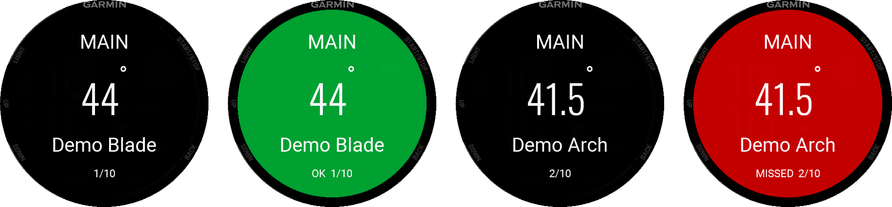
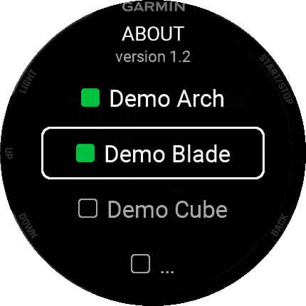
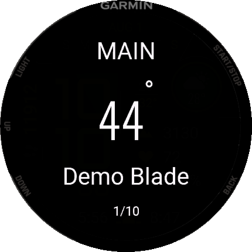
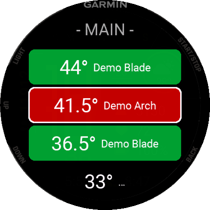
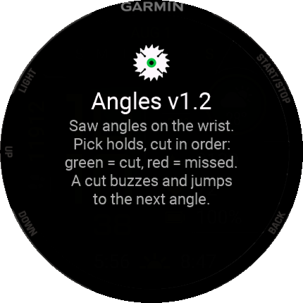

# Angles — Garmin watch app


**Version 1.2.** A Connect IQ watch app (Monkey C) that puts the saw angles of
the selected holds on the wrist of the operator. No drawings or images, only
hold names and MAIN / STEFAN angles, one press per cut.

Target devices: **Instinct 3 AMOLED 45mm** (tested on the watch) and
**Fenix 6 Pro** (builds clean; the manifest also lists a few other Garmin
models).

<p align="center">
  
  <br><sub>BIG MODE: open angle → START (green) → automatic jump with a short buzz → a skipped angle turns red</sub>
</p>

## Why a watch

At the saw both hands are on the panel and the clamp. A phone has to be taken
out, unlocked and kept clean of sawdust; paper has no memory of what is already
cut. The watch is always on the wrist, readable at a glance, and has physical
buttons: the operator looks down, cuts, presses START once, and the next angle
is already on the screen.

## How it works at the saw

0. **Pair once.** FROM PHONE → the watch shows a 6-digit code → an admin enters
   it in SETTINGS and picks the station (saw or operator). Step by step:
   [`../docs/WATCH_SETUP.md`](../docs/WATCH_SETUP.md).
1. **Pick the job.** Select holds on the website, press **⌚** and choose the
   station, or tick holds on the watch itself.
2. **Open BIG MODE.** One angle per screen in large digits: the set-up
   (MAIN / STEFAN) on top, the hold name below, the position in the job at the
   bottom.
3. **Set the saw, cut, press START.** The screen turns **green**, stays green
   for a moment so the operator sees the confirmation, then the watch gives a
   **short buzz** and **jumps to the next open angle** by itself. A second START
   skips the wait.
4. **Out of order?** Marking an angle while a higher one of the same set-up is
   still open gives a **double buzz**, and the skipped angle shows **red
   (MISSED)**, so it is noticed at the saw and not at assembly.
5. **Done.** When the last angle is cut the watch gives one long buzz and shows
   **ALL DONE**.

Progress is saved on the watch after every press, so Back, leaving the app,
a phone call or a reboot never lose the job.

For the workshop side (what MAIN and STEFAN are, how edges above 45° are cut)
see [`../docs/CUTTING.md`](../docs/CUTTING.md).

## Screens

| Holds | BIG MODE | LIST | About |
|---|---|---|---|
|  |  |  |  |
| Actions on top, then every hold with a checkbox. | One big angle, set-up and hold. | All angles, colored; the focus also jumps after a cut. | Version and a short description. |

**Holds screen** (start screen):

| Item | What it does |
|---|---|
| **BIG MODE** · `N selected` | One angle per screen, large. |
| **LIST** | All angles of the selected holds as a colored list. |
| **RESET PROGRESS** | Asks *Reset progress?*, then clears the cut marks. Keeps the selected holds. |
| **RESET HOLDS** | Asks *Untick all holds?*, then unticks all holds. Keeps the cut marks. |
| **FROM PHONE** · station name | Pulls the catalog and this station's job. Not paired yet: opens **PAIR WATCH** with the code. Shows `no phone / offline` if it fails. |
| **ABOUT** · `version 1.2` | Saw blade icon, version and a short description. |
| hold names | START ticks / unticks a hold (green box = picked). |

**Buttons everywhere:** UP / DOWN move, START selects or marks, BACK goes back.
Hold UP (MENU) jumps to the top of a list (in BIG MODE: back to the first angle).

**Order of angles:** MAIN high → low, then STEFAN high → low.

**Colors:** green = cut; red = missed (not cut, but a later angle of the same
set-up is already cut).

**Vibration:**

| Pattern | Meaning |
|---|---|
| one short buzz | angle cut, jumped to the next one |
| two short buzzes | you marked an angle while a higher one is still open |
| one long buzz | every angle of the job is cut |

All screens are drawn by the app itself (no system menus), so the Instinct 3
round subscreen never covers a row.

## Sync, pairing and stations

The watch talks to the server only through the phone (Garmin Connect +
Bluetooth). It identifies itself with a random token made on first start; the
server stores only its SHA-256 and answers nothing until an admin has paired
the token to a **station**.

1. On the website select holds, press **⌚** and pick the station.
2. The server stores the job for that station (`POST /api/watch?a=send`).
3. When the app starts (or on **FROM PHONE**) the watch calls `GET /api/watch`
   with `Authorization: Bearer <token>`. A *new* job replaces the picked holds
   and clears the cut marks; the same job is not applied twice. The catalog is
   cached too.

Without the phone the app works on what it saved last time. Full guide with
troubleshooting: [`../docs/WATCH_SETUP.md`](../docs/WATCH_SETUP.md); several
operators: [`../docs/MULTI_OPERATOR.md`](../docs/MULTI_OPERATOR.md).

### `/api/watch` for the watch

| Request | Answer |
|---|---|
| `GET /api/watch` (paired) | `200 { "r": 7, "h": [["Amon", [24.7, 39.8], [32, 39.8]], ...], "s": ["Amon"], "t": 1790939847, "n": "Saw 1" }` |
| `GET /api/watch` (unknown token) | `401 { "e": "unpaired" }` |
| `GET /api/watch` (waiting) | `403 { "e": "pending", "c": "123456" }` |
| `POST /api/watch?a=pair` | `200 { "c": "123456" }` (valid 15 min) |

`h` — catalog rows `[name, [main], [stefan]]` (no images, ~3.5 KB);
`s` — hold names of this station's job; `t` — send time in unix **seconds**
(fits a Connect IQ 32-bit Number); `n` — station name.

## What changed in 1.2

- **Pairing:** PAIR WATCH screen with a 6-digit code; it polls every 5 s and
  shows PAIRED with the station name when the admin approves. START asks again
  (new code if the old one expired).
- **Token:** every request carries the watch token; an unknown watch gets no
  catalog.
- **Station name** under FROM PHONE.
- **No AVA data in the build:** the bundled offline catalog is empty by
  default; the real catalog arrives on the first sync after pairing.

## What changed in 1.1

- **Auto-advance:** after START the angle stays green for 0.7 s, then a short
  buzz and an automatic jump to the next open angle (BIG MODE and LIST). If
  nothing is open after the current angle, the jump goes back to the first
  missed one.
- **ALL DONE** with a long buzz when the job is finished.
- **ABOUT** item with the version and a short description.
- **New launcher icon:** a saw blade with teeth instead of the angle sign.

## Build

Requirements: Connect IQ SDK (9.x tested) with the device files installed via
the SDK Manager, Java 17, and a developer key (`developer_key.der`). The key
and build output are **not** committed (`.gitignore`).

```bash
# 1. Optional: bundle an offline catalog from an admin EXPORT (default: empty)
node garmin/tools/build-catalog.mjs path/to/Base_export.json

# 2. Optional: redraw the launcher icon (Python + Pillow)
python garmin/tools/build-icon.py

# 3. Build (adjust SDK and key paths)
monkeyc -f garmin/monkey.jungle -d instinct3amoled45mm -o garmin/bin/angles-instinct3amoled45mm.prg -y path/to/developer_key.der
monkeyc -f garmin/monkey.jungle -d fenix6pro           -o garmin/bin/angles-fenix6pro.prg           -y path/to/developer_key.der
```

The bundled catalog (`resources/jsonData/catalog.json`) is empty in the
repository. It is only a fallback for the very first start without a phone;
after the first sync the watch uses its cached copy from the server.

## Install (sideload)

Connect the watch by USB and copy the `.prg` for your model to `GARMIN\APPS`.
Replace the file to update. Saved holds and progress are kept across updates.

## Files

| File | Purpose |
|---|---|
| `source/AnglesApp.mc` | App entry, version, token, pairing and sync with `/api/watch`. |
| `source/ScrollList.mc` | Shared full-screen list (focus row in the middle) + button delegate. |
| `source/HoldsView.mc` | Holds screen, its actions and reset confirmations. |
| `source/Progress.mc` | Ordered cut list, saved cut marks, missed detection, vibration, auto-advance timer. |
| `source/BigView.mc` | BIG MODE screen and buttons. |
| `source/AnglesView.mc` | Colored LIST view. |
| `source/AboutView.mc` | ABOUT screen. |
| `source/PairView.mc` | PAIR WATCH screen: code, polling, PAIRED. |
| `tools/build-catalog.mjs` | Writes the bundled catalog from an admin EXPORT file. |
| `tools/build-icon.py` | Draws the saw blade launcher icon. |
| `docs/screenshots/` | Simulator screenshots (Instinct 3 AMOLED 45mm). |

## Notes from writing it in Monkey C

- **System menus were replaced by custom-drawn lists.** `Menu2` on the
  Instinct 3 reserves the round subscreen in the corner; drawing rows with
  `Dc` gives the full screen and lets the focused row sit in the middle.
- **Round screens need geometry.** Each row computes the chord of the circle at
  its height and shortens long hold names with an ellipsis so text never runs
  off the edge.
- **Number fonts have no degree sign.** BIG MODE draws the digits in
  `FONT_NUMBER_THAI_HOT` and the `°` separately in a text font.
- **Storage instead of state.** Cut marks are keyed by `saw|hold|angle` and
  written to `Application.Storage` on every press, so nothing depends on the
  app staying open.
- **Small payloads.** Connect IQ web requests go through the phone and must stay
  small, so `/api/watch` sends a compact array catalog (~3.5 KB) and a send
  time in seconds that fits a 32-bit Number.
